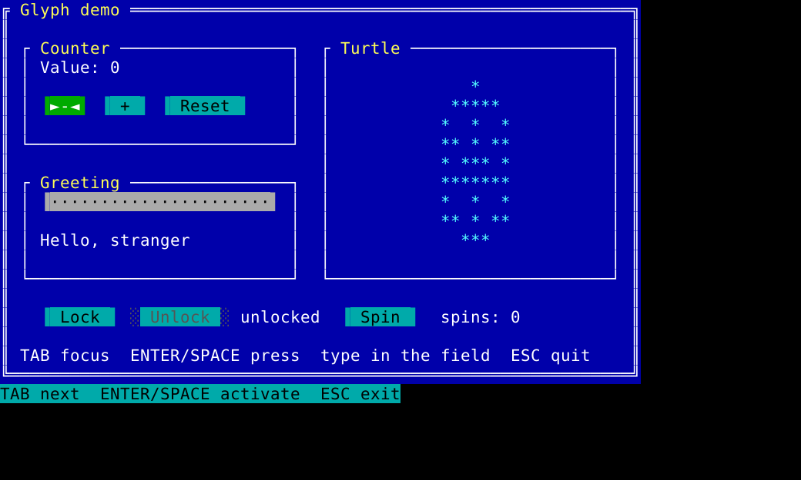
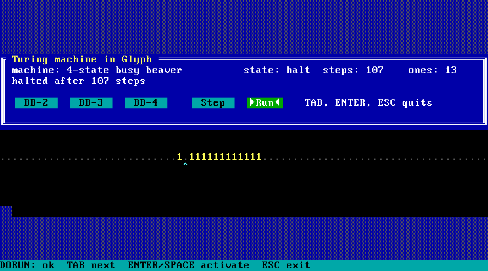
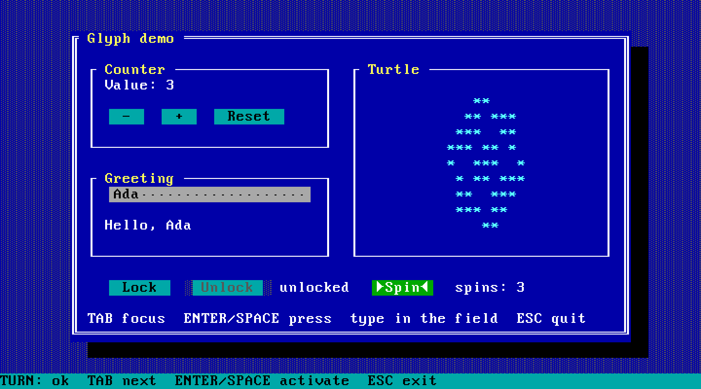
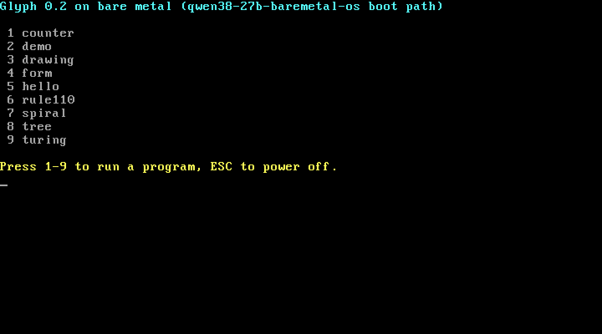
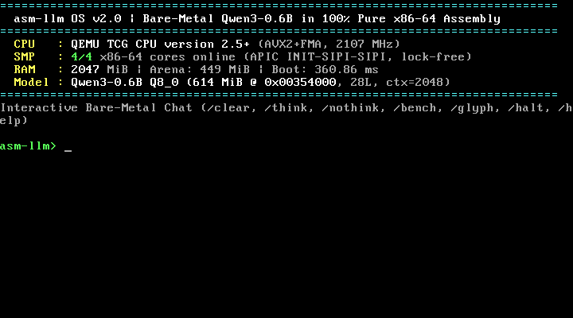

# Glyph

Glyph is a compact, deterministic, **Turing-complete LOGO** for small interactive
text-mode applications. It is designed to be generated by a local LLM and run
inside the bare-metal kernel in this repository.

- It starts from the LOGO of [nanochess/bootLogo](https://github.com/nanochess/bootLogo).
- It follows UCBLogo for procedures with inputs, `OUTPUT`/`STOP`, recursion,
  `IF`/`IFELSE`/`WHILE` and expressions.
- It adds arrays, text-cell drawing, a small component model (panels, labels,
  buttons, fields) and event handlers.

Every resource is bounded and every execution entry has a step budget, so
untrusted programs fail with a diagnostic instead of crashing or hanging.

One interpreter core (`src/core/`, freestanding C99) is compiled unchanged for
two targets:

- **Linux host:** the `glyph` executable, used for development, tests and
  interactive use in a terminal.
- **Bare metal:** `src/baremetal/glyph_bm.c` drives the same core through this
  repository's existing VGA, PS/2 and COM1 drivers.

Lineage: germination GM-CI-003, Glyph track, experiment EXP-003, in
`Pointhairedboss/germinations`.

```
TO fact :n
  IF :n = 0 [OUTPUT 1]
  OUTPUT :n * fact :n - 1
END
TO tree :len :depth
  IF :depth = 0 [STOP]
  FD :len LT 30 tree :len * 3 / 4 :depth - 1
  RT 60 tree :len * 3 / 4 :depth - 1 LT 30 BK :len
END
```

An interactive app is just as short:

```
SCREEN 34 7
SET count 0
PANEL frame 0 0 34 7 "Counter"
LABEL cap 2 2 "Count:"
LABEL val 9 2 :count
BUTTON dec 2 4 "-1" down
BUTTON inc 9 4 "+1" up
ON up ADD count 1
ON down IF :count > 0 [ADD count -1]
```

```
+ Counter -----------------------+
|                                |
| Count: 2                       |
|                                |
| > -1 < [ +1 ]                  |
|                                |
+--------------------------------+
```

## Screenshots

These are real `glyph run` sessions on the Linux host: an 80×25 xterm with the VGA
16-colour palette, driven by real key presses. For the same programs booted as
a kernel in QEMU, see [Booting in a VM](#booting-in-a-vm). Regenerate them with `make screenshots`
(needs Xvfb, xterm, xdotool and ImageMagick).


*`examples/turing.glyph`: a Turing machine written in Glyph, halted after the
4-state busy beaver's 107 steps with 13 ones on the tape.*

| | |
|---|---|
|  |  |
| Turing machine: BB-4 loaded | …after 12 presses of Step |
|  |  |
| Rule 110, 24 generations (`examples/rule110.glyph`) | Recursive tree, `fib 20` and `12!` (`examples/tree.glyph`) |
|  |  |
| UI demo at start (`examples/demo.glyph`) | After +1 ×3, typing "Ada" and three spins |
|  |  |
| Locked: controls disabled, focus moved to Unlock | `glyph check` diagnostics for typical generated-code mistakes |

## Booting in a VM

`make glyph-os` builds `build/glyph-os.elf`, an 88 KB Multiboot kernel. It is
made of this repository's **unmodified** Phase 2 `boot.asm`, `drivers.asm`,
`runtime.asm` and `linker.ld`, plus Glyph and a small `kernel_main`
(`src/baremetal/glyph_os.c`). It has the examples and the conformance corpus
built in. It does not include the Qwen inference engine.

```sh
make qemu-run APP=turing                         # VGA window; ESC opens a menu, ESC again powers off
make qemu-run QEMU_DISPLAY='-display curses'     # the same in a terminal
make qemu-test                                   # bare-metal conformance: 55 transcripts vs the host
make vm-screenshots                              # VGA screenshots via QEMU sendkey/screendump
```

Under QEMU 8.2 (software emulation, no KVM) it boots in under a second. All **55
transcripts are byte-identical** to the Linux host's, on a CPU with AVX and on
one without. Keys reach Glyph as PS/2 scancodes through the kernel's own keyboard
driver, and the screen is the kernel's VGA text driver:



| | |
|---|---|
|  |  |
| UI demo in QEMU, keys sent as PS/2 scancodes | The kernel's program menu (ESC from an app) |

### Inside the Qwen inference kernel

The Phase 2 inference kernel (`make os` in the repository root) has Glyph linked
in. At the `asm-llm>` chat prompt:

- `/glyph` lists the built-in programs.
- `/glyph NAME` runs one on screen; ESC returns to the chat.
- `/glyphtest` runs the conformance corpus.

Recorded under QEMU with the real **Qwen3-0.6B**, every key typed on the emulated
PS/2 keyboard:



`glyph/tests/qemu_inference_glyph.py` checks this end to end, and all 10 checks
pass:

- Both answers are token-identical to the Linux build, before and after a Glyph
  session.
- `/glyph` and `/glyph turing` work, and ESC returns to the chat.
- `/glyphtest` gives 55/55 transcripts identical to the host, inside the inference
  kernel.

Without KVM, QEMU emulates the AVX2 kernels in software. Inference ran at about
0.18 tokens/s, so each answer took about 2.5 minutes. With `-enable-kvm` it runs
at native speed.

```sh
make os inference                                # repository root
python3 -I glyph/tests/qemu_inference_glyph.py models/qwen3-0.6b-q8_0.asmbin
python3 -I glyph/tools/qemu_showcase.py models/qwen3-0.6b-q8_0.asmbin   # records the GIF
```

### `/draw`: the model writes Glyph, the kernel draws it

```
asm-llm> /draw a hexagon
[draw] asking the model for a Glyph program
a hexagon: REPEAT 6 [FD 10 RT 60]
[draw] drawing it (ESC returns)
```

The model's reply streams to the screen. Glyph then pulls the program out of it
(`glyph_extract` drops prose, Markdown and labels) and checks it like any other
untrusted source. If the program has an error, the error goes back to the model
for a fix, at most twice. Then the program runs on VGA until ESC. The kernel side
is one function, `glyph_generate`, that sets up a turn the way `/bench` does.
docs/DRAW.md has the details, the prompt, and how it was chosen.

Recorded under QEMU with the real Qwen3-0.6B: typing the request, the reply
streaming as the model decodes, the drawing, then ESC:

![/draw a hexagon: the model writes REPEAT 6 [FD 10 RT 60] and Glyph draws it](docs/screenshots/inference-draw.gif)

`tests/qemu_draw.py` passes all 7 checks on the final kernel:
- The prompt and the 18 generated tokens are identical to the Linux build.
- The kernel draws the program the Linux extraction gives, on the first attempt.
- The next question is still answered identically ("Paris").

One `/draw` takes about 9 minutes under TCG. The 0.6B model writes valid Glyph
reliably, but gets the shape right only for simple polygons (docs/DRAW.md).

```sh
python3 -I glyph/tests/qemu_draw.py models/qwen3-0.6b-q8_0.asmbin "a hexagon"
python3 -I glyph/tools/qemu_showcase.py --draw "a hexagon" models/qwen3-0.6b-q8_0.asmbin
python3 -I glyph/tools/draw_eval.py "a star" "a house"     # score the prompt on Linux
```

Not yet done: a run on P510 hardware, the fork's full `scripts/verify_os.py`
parity suite (it needs KVM), and the Phase 4 kernel (`docs/BACKEND.md` §4–5).

## Build and test (Linux)

You need a C99 compiler, GNU make and binutils. clang with compiler-rt
(`libclang-rt-*-dev`) is needed for fuzzing, valgrind for the memcheck run, and
nasm for the bare-metal link checks.

```sh
cd glyph
make                 # build/glyph
make test            # unit tests + conformance corpus + example transcripts
make sanitize        # same, built with ASan + UBSan
make valgrind        # same, under valgrind memcheck
make fuzz            # libFuzzer + ASan + UBSan, FUZZ_SECONDS=60 by default
make freestanding    # core compiled with kernel flags; proves zero external symbols
make baremetal-link  # core + adapter linked against ../02-* and ../04-*/drivers.asm
make kernel-link     # full link of the Phase 2 and Phase 4 kernels with Glyph (Phase 2 as pinned and as changed)
make reference       # Turing machines, Rule 110, recursion checked against Python (python3)
make screenshots     # regenerate docs/screenshots (Xvfb, xterm, xdotool, ImageMagick)
make qemu-test       # boot the Glyph kernel in QEMU, compare 55 transcripts with the host (qemu-system-x86)
make check-all       # everything except fuzz
```

## Use

```sh
./build/glyph run examples/turing.glyph          # a Turing machine running busy beavers
./build/glyph run examples/demo.glyph            # interactive: TAB, ENTER/SPACE, type, ESC quits
./build/glyph run --budget 1000000 FILE          # allow longer computations per input
./build/glyph check examples/*.glyph             # validate; errors as file:line:col: error CODE: msg
./build/glyph replay examples/counter.glyph      # headless: print frame and state
./build/glyph replay examples/demo.glyph examples/demo.events   # scripted session transcript
./build/glyph test tests/corpus                  # conformance corpus
./build/glyph dump examples/demo.glyph           # compiled bytecode, units, components, globals
./build/glyph extract tests/model-output/fenced.txt   # the program in a model's reply (docs/DRAW.md)
./build/glyph limits                             # compiled-in limits and sizeof(glyph_vm)
```

## Layout

| Path | Contents |
|---|---|
| `include/glyph.h` | Core API: load, start, inputs, render, state introspection |
| `include/glyph_backend.h` | Backend interface, shared runner, conformance harness |
| `include/glyph_limits.h` | Every resource limit |
| `src/core/` | Shared core: `lex`, `parse` (compiler to bytecode), `exec` (stack VM), `turtle`, `ui`, `runner`, `script`, `extract` (programs out of model replies), `util` |
| `src/host/` | Linux CLI (`main.c`) and terminal backend (`term.c`) |
| `src/baremetal/` | Bare-metal adapter (`glyph_bm.c`), stack-aligning NASM shims, `glyph_os.c` (`kernel_main` of the bootable Glyph kernel), the inference-kernel REPL hook (`glyph_repl.c`), the `/draw` loop (`glyph_draw.c`) and its model-text helper (`glyph_model.asm`) |
| `tests/unit.c` | Unit tests, one section per required category |
| `tests/corpus/` | Shared conformance corpus: `.glyph` + `.events` → `.expect` transcript |
| `tests/fuzz.c` | libFuzzer target (program + event script) |
| `tests/kernel_link.sh` | Kernel link check for Phase 2 and Phase 4 |
| `tests/reference/check_tc.py` | Independent Python checks of the Turing machine, Rule 110 and recursion results |
| `tests/qemu_conformance.py` | Boots the Glyph kernel in QEMU and compares its COM1 transcripts with the host's |
| `tests/qemu_inference_glyph.py`, `tests/qemu_draw.py` | Boot the inference kernel with the real model in QEMU: `/glyph`, `/glyphtest`, `/draw` against the Linux build (`tests/qemu_kernel.py` is the shared harness) |
| `tests/model-output/` | Sample model replies, used as fuzz seeds for `glyph_extract` |
| `tools/` | `mkpayload.sh` (embeds programs in the kernel), `screenshots.sh`, `qemu_shots.py`, `qemu_showcase.py` (GIFs), `draw_primer.txt`/`draw_repair.txt` (the `/draw` prompts) and `draw_eval.py` (scores them on Linux) |
| `examples/` | Example programs; each has an expected transcript and is tested |
| `docs/screenshots/` | Screenshots of real sessions (`tools/screenshots.sh`) |
| `docs/SPEC.md` | Language specification |
| `docs/ARCHITECTURE.md` | Modules, memory, determinism, untrusted input, embedding API |
| `docs/BACKEND.md` | Backend interface, fork driver ABI, bare-metal integration notes |
| `docs/DECISIONS.md` | Design decisions, bootLogo deviations, known limitations, next milestones |
| `docs/DRAW.md` | `/draw`: how the model's reply becomes a drawing, the prompt and how it was chosen |
| `NOTICE` | Provenance and the bootLogo licence |

## Examples

| File | Shows |
|---|---|
| `examples/turing.glyph` | **A Turing machine in Glyph.** Table-driven, with buttons for the 2-, 3- and 4-state busy beavers, Step and Run (107 steps, 13 ones for BB-4). |
| `examples/rule110.glyph` | Rule 110, the Turing-complete cellular automaton, for 24 generations |
| `examples/tree.glyph` | Classic LOGO recursion: a binary tree, `fib 20`, `12!` |
| `examples/demo.glyph` | **The interactive UI demo.** A counter, a name field with live greeting, Lock/Unlock (ENABLE/DISABLE) and a turtle emblem redrawn by procedures on each Spin. |
| `examples/counter.glyph` | Buttons, a bound label and state |
| `examples/form.glyph` | Two fields, a submit button and a status label |
| `examples/spiral.glyph` | Pure LOGO: procedures, nested REPEAT |
| `examples/drawing.glyph` | TEXT, LINE, RECT, BOX and colours |
| `examples/hello.glyph` | Minimal program |

## Status

v0.2 is the Turing-complete language. It covers stages 1–3 of the mission and the
portability part of stage 4, and has been built and tested on Linux. The
bare-metal side builds a bootable Glyph kernel. That kernel passes the full
conformance corpus under QEMU, and Glyph also links into both of the fork's
inference kernels. In the Phase 2 inference kernel, `/glyph` runs Glyph alongside
a real Qwen3-0.6B. Under QEMU, inference stays token-identical before and after
Glyph runs. It has not yet run on P510 hardware. See
`docs/BACKEND.md` §4–5 and `docs/DECISIONS.md` for limitations and next
milestones.
