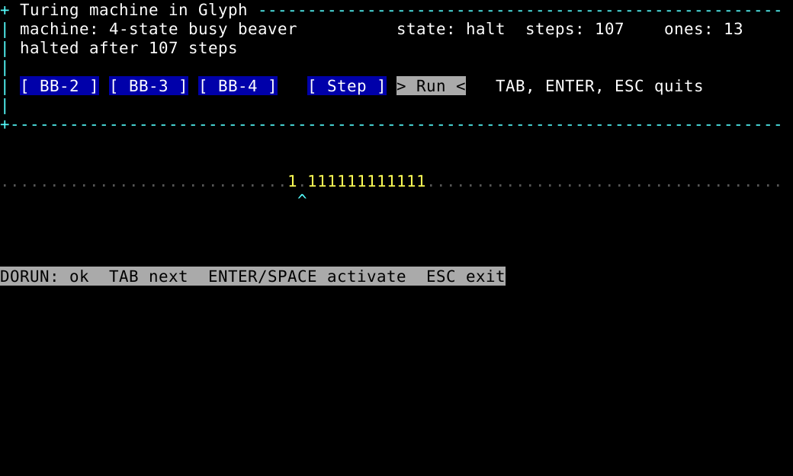
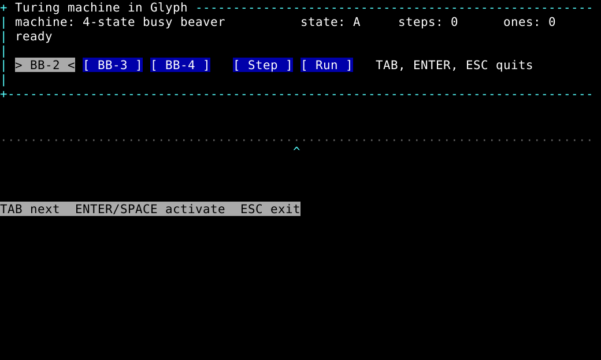
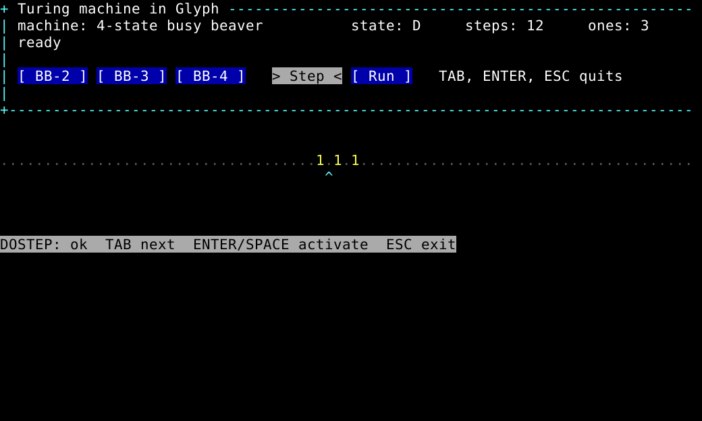
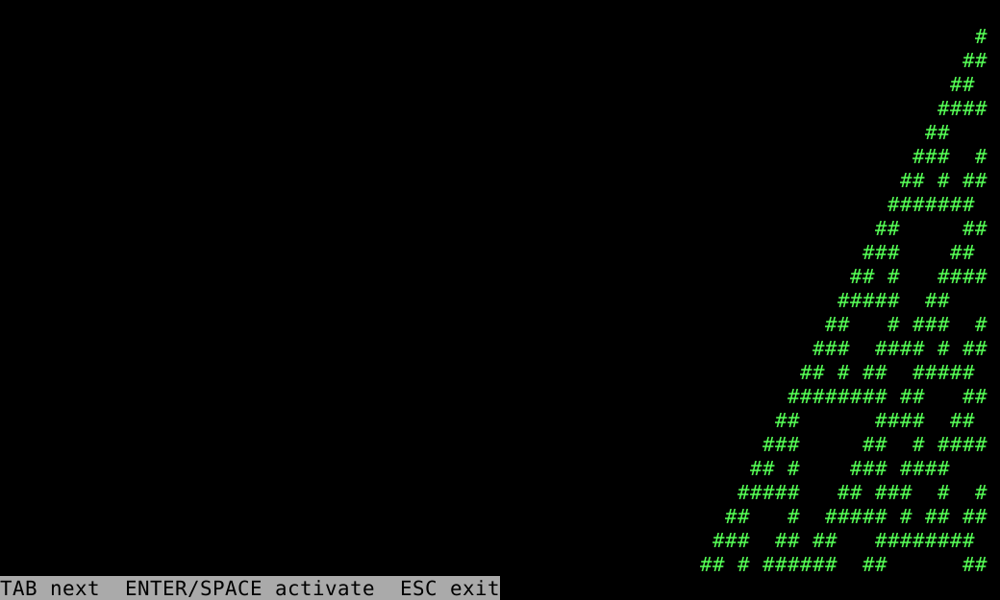
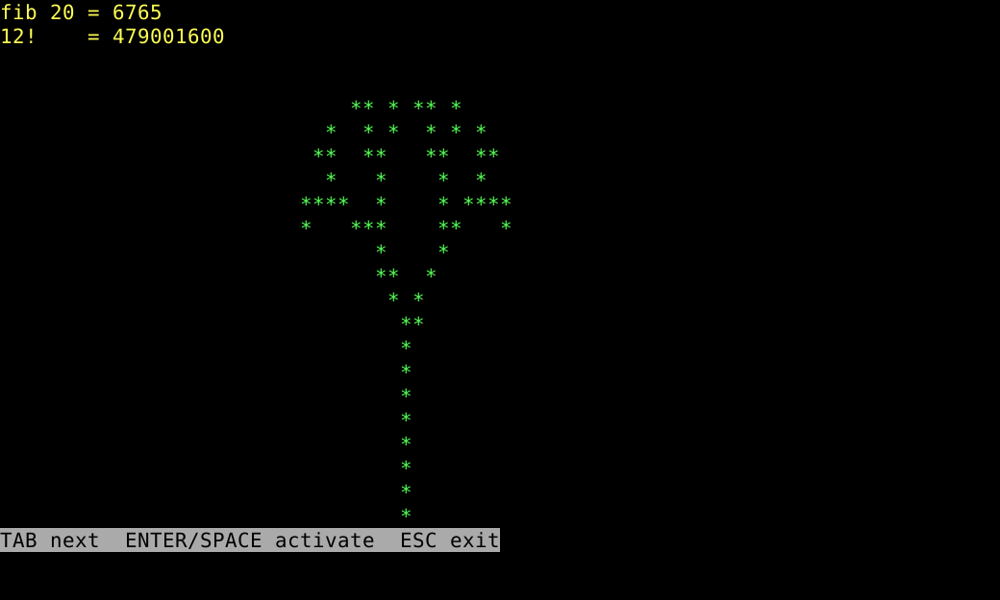
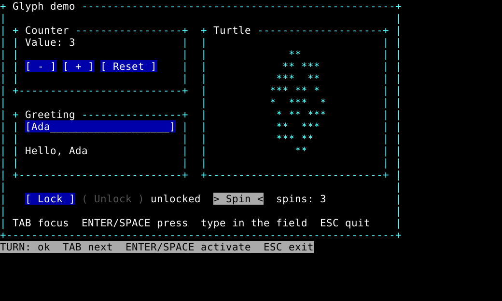
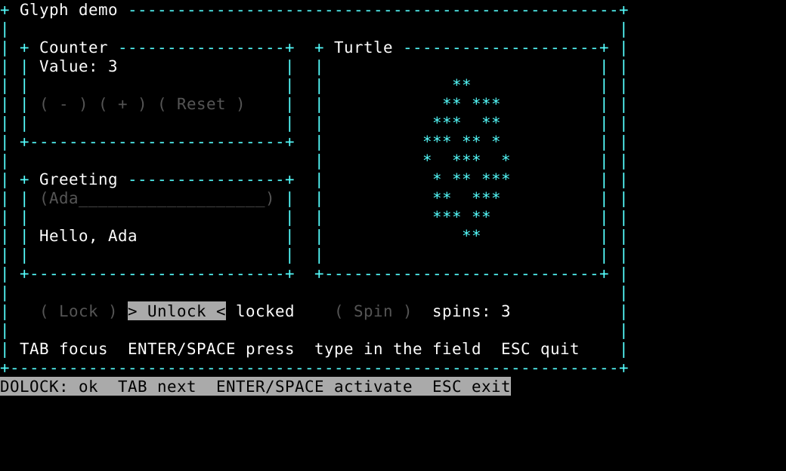
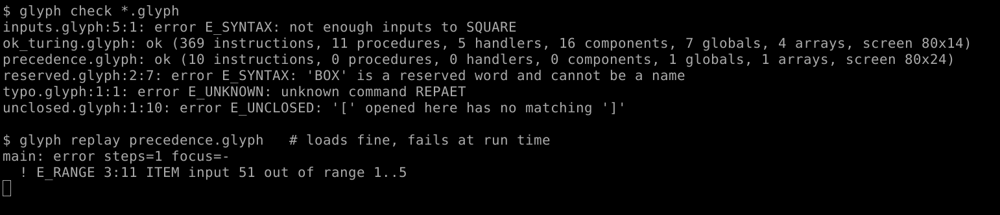

# Glyph

Glyph is a compact, deterministic, **Turing-complete LOGO** for small interactive
text-mode applications. It is designed to be generated by a local LLM and run
inside the bare-metal kernel in this repository.

- It starts from the LOGO of [nanochess/bootLogo](https://github.com/nanochess/bootLogo).
- It follows UCBLogo for procedures with inputs, `OUTPUT`/`STOP`, recursion,
  `IF`/`IFELSE`/`WHILE` and expressions.
- It adds arrays, text-cell drawing, a small component model (panels, labels,
  buttons, fields) and event handlers.

Every resource is bounded and every execution entry has a step budget, so
untrusted programs fail with a diagnostic instead of crashing or hanging.

One interpreter core (`src/core/`, freestanding C99) is compiled unchanged for
two targets:

- **Linux host:** the `glyph` executable, used for development, tests and
  interactive use in a terminal.
- **Bare metal:** `src/baremetal/glyph_bm.c` drives the same core through this
  repository's existing VGA, PS/2 and COM1 drivers.

Lineage: germination GM-CI-003, Glyph track, experiment EXP-003, in
`Pointhairedboss/germinations`.

```
TO fact :n
  IF :n = 0 [OUTPUT 1]
  OUTPUT :n * fact :n - 1
END
TO tree :len :depth
  IF :depth = 0 [STOP]
  FD :len LT 30 tree :len * 3 / 4 :depth - 1
  RT 60 tree :len * 3 / 4 :depth - 1 LT 30 BK :len
END
```

An interactive app is just as short:

```
SCREEN 34 7
SET count 0
PANEL frame 0 0 34 7 "Counter"
LABEL cap 2 2 "Count:"
LABEL val 9 2 :count
BUTTON dec 2 4 "-1" down
BUTTON inc 9 4 "+1" up
ON up ADD count 1
ON down IF :count > 0 [ADD count -1]
```

```
+ Counter -----------------------+
|                                |
| Count: 2                       |
|                                |
| > -1 < [ +1 ]                  |
|                                |
+--------------------------------+
```

## Screenshots

These are real `glyph run` sessions on the Linux host: an 80×25 xterm with the VGA
16-colour palette, driven by real key presses. They are not from the bare-metal
target, which has not been booted yet. Regenerate them with `make screenshots`
(needs Xvfb, xterm, xdotool and ImageMagick).



*`examples/turing.glyph`: a Turing machine written in Glyph, halted after the
4-state busy beaver's 107 steps with 13 ones on the tape.*

| | |
|---|---|
|  |  |
| Turing machine: BB-4 loaded | …after 12 presses of Step |
|  |  |
| Rule 110, 24 generations (`examples/rule110.glyph`) | Recursive tree, `fib 20` and `12!` (`examples/tree.glyph`) |
|  |  |
| UI demo at start (`examples/demo.glyph`) | After +1 ×3, typing "Ada" and three spins |
|  |  |
| Locked: controls disabled, focus moved to Unlock | `glyph check` diagnostics for typical generated-code mistakes |

## Build and test (Linux)

You need a C99 compiler, GNU make and binutils. clang with compiler-rt
(`libclang-rt-*-dev`) is needed for fuzzing, valgrind for the memcheck run, and
nasm for the bare-metal link checks.

```sh
cd glyph
make                 # build/glyph
make test            # unit tests + conformance corpus + example transcripts
make sanitize        # same, built with ASan + UBSan
make valgrind        # same, under valgrind memcheck
make fuzz            # libFuzzer + ASan + UBSan, FUZZ_SECONDS=60 by default
make freestanding    # core compiled with kernel flags; proves zero external symbols
make baremetal-link  # core + adapter linked against ../02-* and ../04-*/drivers.asm
make kernel-link     # full link of the unmodified Phase 2 and Phase 4 kernels with Glyph
make reference       # Turing machines, Rule 110, recursion checked against Python (python3)
make screenshots     # regenerate docs/screenshots (Xvfb, xterm, xdotool, ImageMagick)
make check-all       # everything except fuzz
```

## Use

```sh
./build/glyph run examples/turing.glyph          # a Turing machine running busy beavers
./build/glyph run examples/demo.glyph            # interactive: TAB, ENTER/SPACE, type, ESC quits
./build/glyph run --budget 1000000 FILE          # allow longer computations per input
./build/glyph check examples/*.glyph             # validate; errors as file:line:col: error CODE: msg
./build/glyph replay examples/counter.glyph      # headless: print frame and state
./build/glyph replay examples/demo.glyph examples/demo.events   # scripted session transcript
./build/glyph test tests/corpus                  # conformance corpus
./build/glyph dump examples/demo.glyph           # compiled bytecode, units, components, globals
./build/glyph limits                             # compiled-in limits and sizeof(glyph_vm)
```

## Layout

| Path | Contents |
|---|---|
| `include/glyph.h` | Core API: load, start, inputs, render, state introspection |
| `include/glyph_backend.h` | Backend interface, shared runner, conformance harness |
| `include/glyph_limits.h` | Every resource limit |
| `src/core/` | Shared core: `lex`, `parse` (compiler to bytecode), `exec` (stack VM), `turtle`, `ui`, `runner`, `script`, `util` |
| `src/host/` | Linux CLI (`main.c`) and terminal backend (`term.c`) |
| `src/baremetal/` | Bare-metal adapter (`glyph_bm.c`) and stack-aligning NASM shims |
| `tests/unit.c` | Unit tests, one section per required category |
| `tests/corpus/` | Shared conformance corpus: `.glyph` + `.events` → `.expect` transcript |
| `tests/fuzz.c` | libFuzzer target (program + event script) |
| `tests/kernel_link.sh` | Kernel link check for Phase 2 and Phase 4 |
| `tests/reference/check_tc.py` | Independent Python checks of the Turing machine, Rule 110 and recursion results |
| `examples/` | Example programs; each has an expected transcript and is tested |
| `docs/screenshots/` | Screenshots of real sessions (`tools/screenshots.sh`) |
| `docs/SPEC.md` | Language specification |
| `docs/ARCHITECTURE.md` | Modules, memory, determinism, untrusted input, embedding API |
| `docs/BACKEND.md` | Backend interface, fork driver ABI, bare-metal integration notes |
| `docs/DECISIONS.md` | Design decisions, bootLogo deviations, known limitations, next milestones |
| `NOTICE` | Provenance and the bootLogo licence |

## Examples

| File | Shows |
|---|---|
| `examples/turing.glyph` | **A Turing machine in Glyph.** Table-driven, with buttons for the 2-, 3- and 4-state busy beavers, Step and Run (107 steps, 13 ones for BB-4). |
| `examples/rule110.glyph` | Rule 110, the Turing-complete cellular automaton, for 24 generations |
| `examples/tree.glyph` | Classic LOGO recursion: a binary tree, `fib 20`, `12!` |
| `examples/demo.glyph` | **The interactive UI demo.** A counter, a name field with live greeting, Lock/Unlock (ENABLE/DISABLE) and a turtle emblem redrawn by procedures on each Spin. |
| `examples/counter.glyph` | Buttons, a bound label and state |
| `examples/form.glyph` | Two fields, a submit button and a status label |
| `examples/spiral.glyph` | Pure LOGO: procedures, nested REPEAT |
| `examples/drawing.glyph` | TEXT, LINE, RECT, BOX and colours |
| `examples/hello.glyph` | Minimal program |

## Status

v0.2 is the Turing-complete language. It covers stages 1–3 of the mission and the
portability part of stage 4, and has been built and tested on Linux. The
bare-metal target has been compiled and linked into both of the fork's kernels,
but **not booted**. See
`docs/BACKEND.md` §4–5 and `docs/DECISIONS.md` for limitations and next
milestones.
