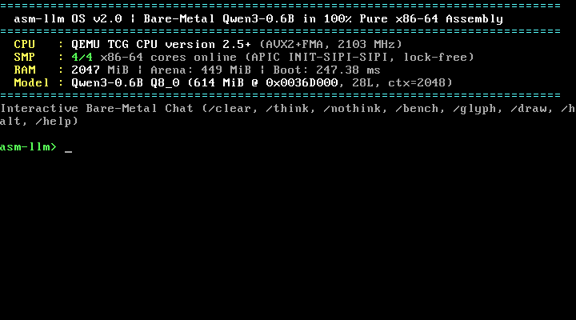
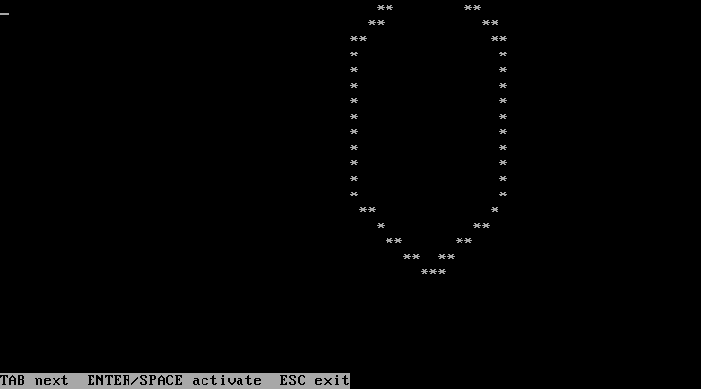
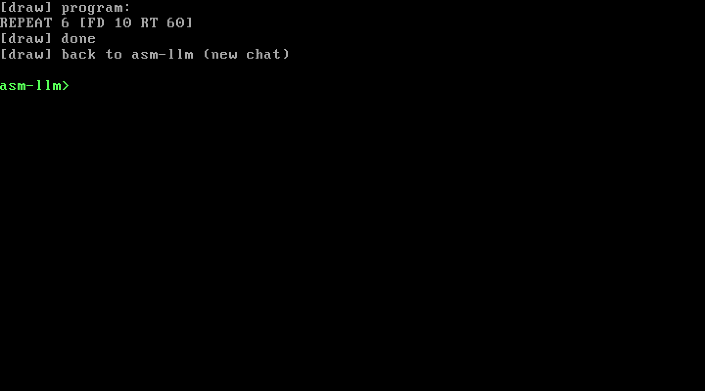

# `/draw` — the model writes Glyph, the kernel draws it

At the `asm-llm>` prompt of the Phase 2 inference kernel:

```
asm-llm> /draw a hexagon
[draw] asking the model for a Glyph program
a hexagon: REPEAT 6 [FD 10 RT 60]
[asm-llm-os] prefill: ...
[draw] drawing it (ESC returns)
        (the drawing, on VGA, until ESC)
[draw] program:
REPEAT 6 [FD 10 RT 60]
[draw] done
[draw] back to asm-llm (new chat)
asm-llm>
```



The model's reply streams to the screen as it decodes, like any answer. Glyph
then pulls the program out of the reply, checks it, and runs it under the step
budget. ESC returns to the chat.

## How it works

```
 REPL line "/draw REQUEST"
   │  kernel.asm → glyph_shell_repl → glyph_repl_command (glyph_repl.c)
   ▼
 glyph_draw (glyph_draw.c, portable, tested on the host with a fake model)
   1. prompt = tools/draw_primer.txt with {REQUEST}
   2. reply  = glyph_generate(prompt, 64)          kernel.asm: one fresh turn, as /bench
               glyph_model_text(n, buf, cap)       glyph_model.asm: token ids → bytes
   3. glyph_extract(reply)                         src/core/extract.c
        ok          → 4
        code error  → prompt = tools/draw_repair.txt with {REQUEST} {PROGRAM}
                      {ERROR}="line L: message"; back to 2 (at most 2 repairs)
        no program  → stop (greedy decoding would repeat the same reply)
   4. glyph_bm_run(program)                        VGA + PS/2/COM1 until ESC
```

**The kernel side** is `glyph_generate` in `02-baremetal-os/kernel.asm` (about 30
lines) and one store in `run_inference` that records the number of generated
tokens. `glyph_generate` does what `/bench` does: it saves the options, sets
one fresh greedy turn (no thinking, the chat template, 64 tokens), calls the unchanged
`run_inference`, and restores the options. The turn starts at position 0 of the
KV cache, so the chat starts afresh afterwards, as after `/bench` (D28).
`glyph_model_text` (in `glyph/`, not the kernel) turns the token ids at
`[g_ctx + CTX_BUF_GEN]` into the bytes `tok_write_stdout` prints, using the CTX
offsets from the fork's `shared/constants.inc`. Prefill, decode, sampling, the
scheduler, SMP and the drivers are not touched.

**The model's reply is untrusted input.** It goes through `glyph_extract` and
`glyph_load` like any other source, so every limit of SPEC §11 applies and a
bad reply gives a diagnostic, not a crash. The program then runs under the
default step budget. The request is limited to 160 bytes; every buffer is fixed
size and every copy is bounded. The core, the extractor and the `/draw` loop
are fuzzed and tested under ASan/UBSan and Valgrind on the host.

**`glyph_extract`** (D27) cleans the reply line by line:

- It drops ``` fences, `<think>` tags, headings, and lines that end with `:`.
- It removes list markers (`- `, `* `, `3. `, `3) `), labels up to the first `: `
  (Glyph never has `: ` outside strings and comments), and Markdown around the
  code (`**…**`, `__…__`, `` `…` ``).
- It drops lines that cannot start a statement.

It then loads what is left. When the first error is at a line's first word and
that word is not a Glyph word, or the line has characters only prose uses
(`` ` ? ! , ' `` outside strings and comments), the line is prose: it is dropped
and loading is retried. Any other error is a code error, reported with its
position in the extracted program. `glyph extract FILE` does the same on the
host.

## The prompt

`tools/draw_primer.txt`, assembled into the kernel with `incbin`:

```
Glyph is LOGO on a text screen. Examples:
a square: REPEAT 4 [FD 6 RT 90]
a triangle: REPEAT 3 [FD 8 RT 120]
a circle: REPEAT 36 [FD 1 RT 10]
{REQUEST}:
```

`tools/draw_repair.txt`:

```
Glyph is LOGO. This Glyph program for {REQUEST} has an error.
{PROGRAM}
Error: {ERROR}
Write only the corrected program.
```

The prompt is short on purpose: under QEMU without KVM, every prompt token costs
about 5 seconds.

## Choosing the prompt (D30)

`tools/draw_eval.py` runs the `/draw` loop on the Linux build (`build/asm-llm`,
token-identical to the kernel, about 25 s per request) and replays each program.
Seven prompts were compared on the same 12 requests: hexagon, pentagon, octagon,
star, house, the letter L, plus sign, staircase, zigzag, spiral, big triangle,
small square. All used greedy decoding, 64 tokens per reply, up to 2 repairs and
the final extractor. The prompts' full text, every reply and every drawing are in
`docs/draw-eval.txt`.

| Prompt | Draws something | First try | Right shape (by eye) |
|---|---|---|---|
| **H (kept)**: labelled examples (square, triangle, circle), ends `{REQUEST}:` | 12/12 | 12 | **3**: hexagon `REPEAT 6 [FD 10 RT 60]`, pentagon `REPEAT 5 [FD 10 RT 72]`, big triangle |
| H2: as H with a star instead of the triangle | 12/12 | 11 | 1: big triangle |
| H3: as H plus a steps example | 12/12 | 12 | 0 |
| B: named examples, steps last, "Write only the Glyph program for …" | 12/12 | 12 | 2: staircase (the example itself), small square |
| F: named examples, `line: FD 8` last | 7/12 | 7 | 0 |
| C: a rule, "a shape with N sides is REPEAT N [FD 6 RT 360/N]", one example | 3/12 | 3 | 1: hexagon |
| G: instructions listing the commands, one example | 10/12 | 4 | 2: the L, small square (its octagon and big triangle are right but far larger than the screen) |

What the 0.6B model does:
- It copies the form of the nearest example: steps-shaped programs after a steps
  example, `FD … RT …` lines after `line: FD 8`.
- Labelled examples ending in `{REQUEST}:` get the shortest answers in the format
  the extractor handles best.
- Explaining the rule, or listing the commands, makes it chatty: it writes prose,
  runs out of tokens or leaves brackets open.
- Under H it knows polygon turning angles (60 for 6 sides, 72 for 5), but not
  stars (144), composite shapes (a house) or letters.

"Right shape" is a judgement from one greedy reply per request, so treat the
counts as indicative. H was kept because it has the most right shapes and every
reply worked first time, which matters at about 9 minutes per attempt under TCG.

## Verified end to end under QEMU

`tests/qemu_draw.py`, 2026-11-28: QEMU 8.2 TCG (no KVM), 4 vCPUs, `-cpu max`, 2 GiB,
real Qwen3-0.6B Q8_0, on the final kernel. **7/7 checks pass.**

| Check | Result |
|---|---|
| `/draw` with no request | usage line; nothing generated; chat untouched |
| `/draw a hexagon`: prompt token IDs vs `build/asm-llm` on Linux | identical (77 tokens with the chat template) |
| Generated token IDs vs Linux | identical, 18 tokens: `a hexagon: REPEAT 6 [FD 10 RT 60]` |
| Attempts | 1, as on Linux (the program loaded first time) |
| The program drawn on VGA vs the Linux extraction; ESC returns | identical (`REPEAT 6 [FD 10 RT 60]`); pass |
| Question after `/draw`: "What is the capital of France? Answer in one word." vs Linux | identical: `59604` ("Paris") |

Prefill took 393 s for 77 tokens (0.20 tokens/s) and decoding took 130 s for 18
tokens, so one `/draw` took about 9 minutes under emulation. The COM1 transcript
is `docs/draw-serial.txt`. Screenshots:

| The drawing (VGA) | After ESC |
|---|---|
|  |  |

The hexagon's top edge is clipped. The turtle starts in the middle of the 24-row
screen facing up, and the model's side of 10 cells takes it past the top. Cells
off the screen are not drawn (SPEC §7–8). Text cells are about twice as tall as
they are wide, so the figure also looks stretched (SPEC §7).

## Limits

- **The model is small.** With the kept prompt, Qwen3-0.6B wrote a working program
  for 12 of 12 requests, but only 3 had the right shape (simple polygons; see the
  table). A larger model is the fix; the loop does not depend on which model it is.
- **`/draw` starts a new chat**, as `/bench` does (D28).
- **Greedy decoding only.** `/draw` sets temperature 0 for its turn, whatever the
  kernel was booted with, so the same request always gives the same drawing.
- **Under TCG it is slow**: about 9 minutes per `/draw a hexagon` (95 tokens at
  about 5 s each). With KVM or on hardware it is a few seconds.
- Phase 4 links the same object but has no `glyph_generate` hook yet, so `/draw`
  says it is not available there (D31).
